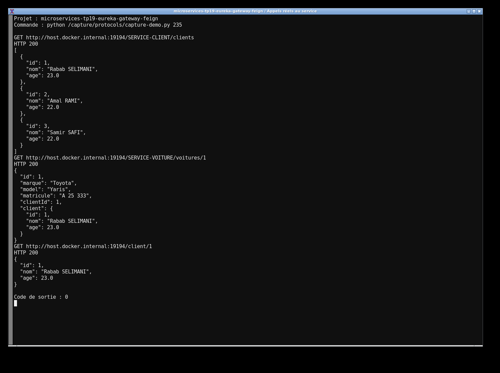
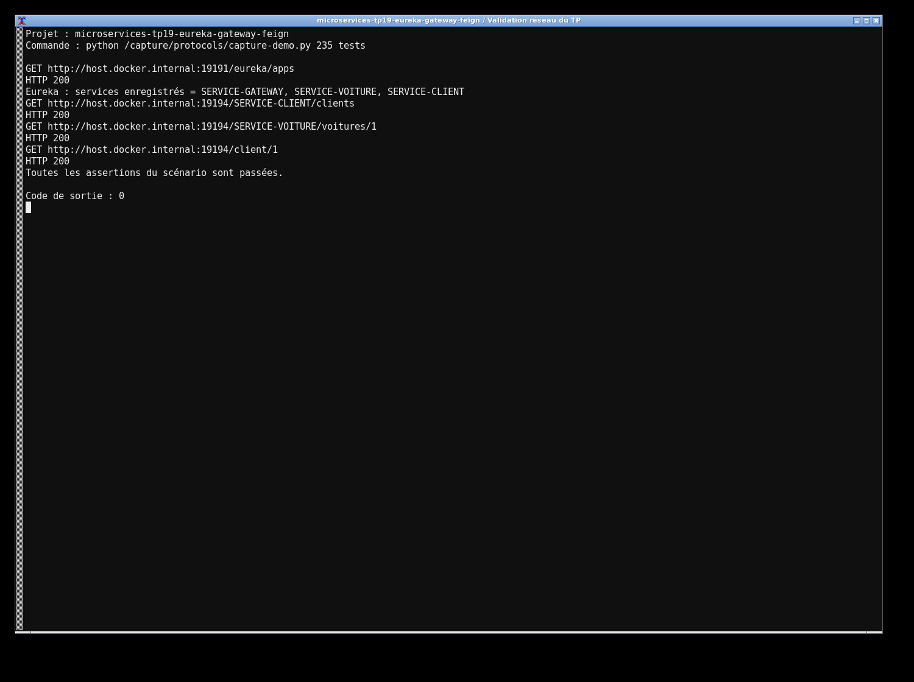

# TP19 — Eureka, Gateway et OpenFeign

J’ai séparé l’application en quatre modules : le registre Eureka, SERVICE-CLIENT, SERVICE-VOITURE et la Gateway. Chaque service métier possède sa base H2. Les voitures stockent seulement clientId ; OpenFeign récupère le client avec son nom logique dans Eureka.

```bash
mvn clean verify
java -jar eureka-server/target/eureka-server-1.0.0.jar
java -jar service-client/target/service-client-1.0.0.jar
java -jar service-voiture/target/service-voiture-1.0.0.jar
java -jar gateway/target/gateway-1.0.0.jar
```

Lancer chaque commande Java dans un terminal. Eureka utilise 8761, Client 8088, Voiture 8089 et la Gateway 8888. Tester `/clients`, `/client/1` et `/voitures/1` via la Gateway. Le routage dynamique accepte également `/SERVICE-CLIENT/clients` et `/SERVICE-VOITURE/voitures`.

Le profil Gateway `static` garde l’étape de routage par URL du TP. Le mode par défaut utilise `lb://` avec découverte et équilibrage de charge. Les données de départ sont ajoutées automatiquement. Les tests HTTP et les appels entre les vrais services sont conservés dans `evidence/`.



